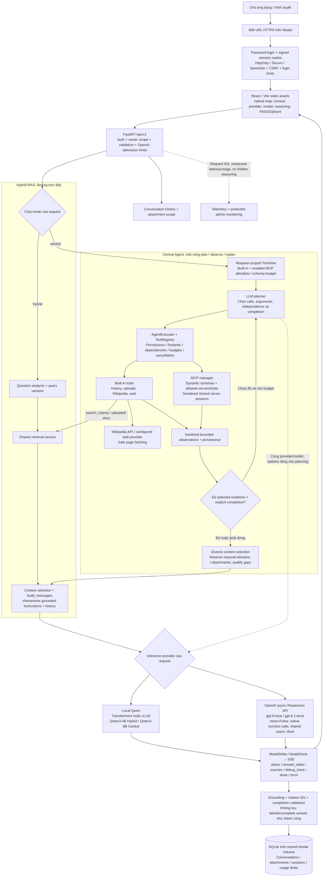
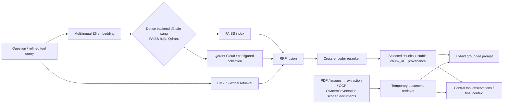
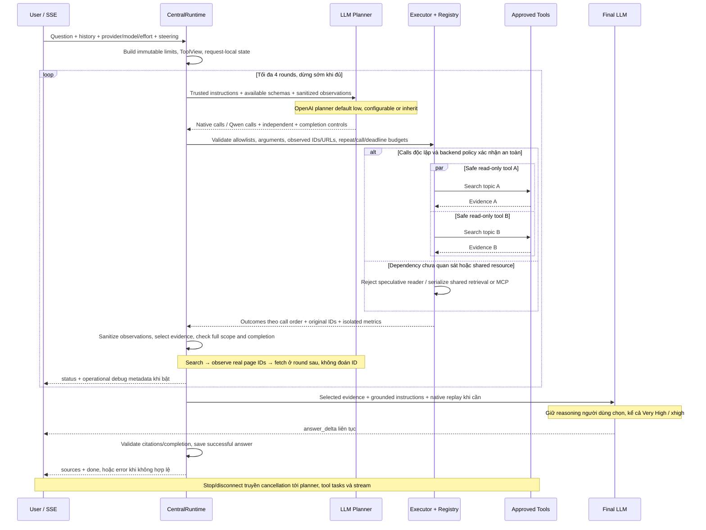
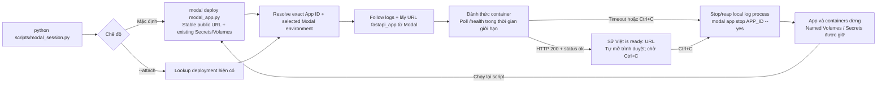

# Sử Việt

**Trợ lý tra cứu lịch sử có dẫn nguồn.**

Sử Việt kết hợp truy xuất tư liệu và mô hình ngôn ngữ để hỗ trợ tìm hiểu lịch sử Việt Nam. Câu trả lời được truyền trực tiếp khi model sinh, kèm nguồn tham khảo để người dùng kiểm tra và đối chiếu.

Ứng dụng hỗ trợ hội thoại, tra cứu tài liệu PDF/ảnh tải lên và lựa chọn FAISS hoặc Qdrant cho từng câu hỏi. Trên Modal, một URL HTTPS phục vụ giao diện và API sau màn hình đăng nhập bằng mật khẩu.

| Chế độ | Cách hoạt động | Model |
| --- | --- | --- |
| **Hybrid RAG** | Truy xuất tư liệu rồi sinh câu trả lời từ context. | Local Qwen3-4B vanilla/SFT hoặc OpenAI Luna/Terra |
| **Central Agent** | Lập kế hoạch, dùng công cụ được cấp quyền và tổng hợp câu trả lời. | Local Qwen3-8B vanilla hoặc OpenAI Luna/Terra |

Backend dùng FastAPI; frontend dùng React/Vite. Retrieval kết hợp E5, FAISS/Qdrant, BM25S và cross-encoder reranking trên Corpus V1.

Inference có thể chọn Qwen local hoặc OpenAI Responses API cho từng request, độc lập với chat mode và dense backend. OpenAI mặc định tắt và được bảo vệ bằng phiên đăng nhập và hạn mức phía máy chủ; xem [cấu hình bảo mật](docs/CONFIGURATION.md#openai-responses-api). Không đặt OpenAI API key trong trình duyệt.

Modal hỗ trợ OpenAI API với retrieval trên CPU hoặc GPU nhỏ: giữ `LOCAL_INFERENCE_ENABLED=false` và đặt `MODAL_RETRIEVAL_GPU_CLASS=T4` để tăng tốc E5/reranker; để trống biến GPU retrieval để chạy CPU-only. Chỉ đặt `LOCAL_INFERENCE_ENABLED=true` khi muốn tải Qwen. Central ưu tiên Qdrant cho tư liệu Việt Nam và Wikipedia cho lịch sử thế giới, đồng thời tôn trọng lựa chọn nguồn/công cụ của người dùng.

[Central Agent v2](docs/AGENTIC_RAG_V2.md) bổ sung dependency checks, chạy song song tool an toàn, replan theo evidence và budgets riêng từng request. Câu hỏi đơn giản vẫn có thể kết thúc sau một retrieval. Evaluation offline và giới hạn của kết quả được ghi kèm trong tài liệu.

## Inference provider: Local và API LLM

| Provider | Model / API ID | Chat mode | Cấu hình reasoning |
| --- | --- | --- | --- |
| Local Qwen | `Qwen/Qwen3-4B-Instruct-2507` vanilla/SFT | Hybrid RAG | Local generation settings; Transformers hoặc vLLM theo cấu hình |
| Local Qwen | `Qwen/Qwen3-8B` vanilla | Central Agent | Action/final generation settings của Qwen |
| **OpenAI API LLM** | **GPT-6 Luna — `gpt-6-luna`** (default OpenAI) | **Hybrid RAG và Central Agent** | Final: Low `low`, Medium `medium`, High `high`, Very High `xhigh` |
| **OpenAI API LLM** | **GPT-6.1 Terra — `gpt-6.1-terra`** | **Hybrid RAG và Central Agent** | Cùng bốn reasoning levels, chọn theo từng request |

Provider/model/effort không ghi đè cấu hình của user khác. OpenAI dùng Responses API chính thức, native streaming/function calling và evidence của ứng dụng. Central OpenAI có planning effort riêng, default `low`, còn final giữ effort UI đã chọn; `inherit` dùng cùng effort cho cả hai. Key chỉ ở server/Modal Secret. `LOCAL_INFERENCE_ENABLED=false` cho phép dùng API LLM mà không tải Qwen; T4/L4 có thể chỉ phục vụ E5/reranker.

## Kiến trúc hệ thống và agent

Ứng dụng dùng **một Central Agent với planner lặp**, cùng đường Hybrid RAG trực tiếp. Planner và final generation là hai giai đoạn của cùng request; scheduler, policy, retriever và guardrails là mã backend xác định, không phải các LLM agents riêng. Provider, chat mode và dense backend được chọn độc lập theo request.

### 1. Toàn hệ thống: một URL, hai đường trả lời



Mũi tên provider của planner biểu thị việc dùng adapter chung; **chỉ final generation** phát `answer_delta` cho người dùng. Tool-call arguments và private reasoning không được stream thành câu trả lời. OpenAI API key và internal credentials ở server/Modal Secrets.

### 2. Retrieval dùng chung, không nhân đôi RAG theo provider



Chọn OpenAI không bỏ qua retrieval. Trong cấu hình API + T4, **E5/reranker chạy trên T4**, còn LLM chạy qua OpenAI; Qwen không được tải. FAISS/Qdrant theo lựa chọn request, không tự đổi backend khi lỗi. Central ưu tiên corpus cho Việt Nam, external evidence cho lịch sử thế giới, trong giới hạn nguồn/công cụ người dùng cho phép.

### 3. Thuật toán vòng lặp Central Agent

**Mã thực thi vòng lặp:** [`CentralRuntime.prepare()`](app/central/runtime.py); **admission/scheduling/tool execution:** [`AgentExecutor.execute()`](app/central/execution.py). Hai provider cùng dùng harness này: OpenAI nhận native function calls, Qwen dùng Hermes decoder.

```mermaid
flowchart TD
    Start["Nhận question + history + steering + provider/model"] --> Init["Tạo request-local state<br/>ToolView, immutable limits, evidence store, counters, deadline"]
    Init --> Cancel{"Đã hủy / browser disconnect?"}
    Cancel -->|Có| Abort["Cancel active async tasks / cooperative workers<br/>Close upstream stream; không lưu successful answer"]
    Cancel -->|Chưa| Budget{"Còn round, deadline<br/>và planning token budget?"}
    Budget -->|Không| ExitBudget["Ghi exit_reason<br/>Round / deadline / token budget"]
    Budget -->|Có| Plan["Gọi LLM planner<br/>Question + available schemas + prior sanitized observations"]
    Plan --> Decode{"Native OpenAI hay local Qwen?"}
    Decode -->|OpenAI| Native["Giữ reasoning/output items và native call IDs<br/>Malformed arguments nhận error output"]
    Decode -->|Qwen| Hermes["Decode Hermes tool calls<br/>Structured completion control"]
    Native --> Envelope{"Envelope hợp lệ<br/>và không quá 64 calls?"}
    Hermes --> Envelope
    Envelope -->|Không| Error["SSE error; đóng resources<br/>Không lưu completed answer"]
    Envelope -->|Có| Calls{"Planner có yêu cầu tool?"}
    Calls -->|Không| NoTools["exit_reason = planner_no_tools"]
    Calls -->|Có| Controls["Strip planner-only controls<br/>completion / explicit independence"]
    Controls --> Admit["Admission từng call<br/>Allowlist + schema + domain + round/total limits<br/>Observed ID/URL + normalized repeat key"]
    Admit --> Allowed{"Call được chấp nhận?"}
    Allowed -->|Không| Rejected["Sanitized rejected outcome<br/>Giữ original call ID; không execute"]
    Allowed -->|Có| Parallel{"Explicitly independent + read-only<br/>+ parallel_safe + resource không xung đột?"}
    Parallel -->|Có| Batch["Bounded concurrent batch<br/>Tối đa 3 safe calls"]
    Parallel -->|Không| Serial["Sequential execution<br/>Retrieval gate / shared MCP session gate"]
    Batch --> Tool["ToolRegistry validate + execute<br/>Isolated context/metrics; per-tool timeout"]
    Serial --> Tool
    Tool --> Failure{"Lỗi tool?"}
    Failure -->|MCP failure_policy = fail| Error
    Failure -->|Recoverable / timeout / empty| Outcome["Success hoặc fixed error outcome"]
    Failure -->|Không| Outcome
    Rejected --> Observe["Restore model call order<br/>Merge completed metrics; ingest evidence/provenance"]
    Outcome --> Observe
    Observe --> Feedback["Bounded valid JSON observations<br/>Native output cho mọi accepted call ID<br/>Tool output là untrusted data"]
    Feedback --> Enough{"Explicit completion + mọi call usable<br/>+ selected evidence cover scope<br/>+ không truncated/pending dependency?"}
    Enough -->|Đủ| Sufficient["exit_reason = evidence_sufficient"]
    Enough -->|Chưa đủ| Remaining{"Còn tool/observation budget<br/>và chưa lặp vô ích / hết deadline?"}
    Remaining -->|Còn| Replan["Replan theo observation<br/>Sửa query / đổi approved tool / fetch observed ID"]
    Replan --> Cancel
    Remaining -->|Hết| Stop["Ghi safe stopping reason<br/>Không tự bịa thêm nguồn"]
    NoTools --> Fallback{"Fallback cũ còn hợp lệ<br/>và được phép, còn budget?"}
    Stop --> Fallback
    ExitBudget --> Fallback
    Fallback -->|Có| FallbackTool["History hoặc Wikipedia fallback<br/>Qua cùng executor, permissions và budgets"]
    FallbackTool --> SelectFinal["Chọn context cuối; reserve required source kinds<br/>Gaps → qualified execution instruction"]
    Fallback -->|Không| SelectFinal
    Sufficient --> SelectFinal
    SelectFinal --> Final["Grounded final generation<br/>Final reasoning người dùng chọn + exact native replay"]
    Final --> SSE["Stream answer_delta<br/>Filter unknown citation IDs"]
    SSE --> Valid{"Completed + nonempty<br/>+ Central citations hợp lệ?"}
    Valid -->|Có| Save["Persist answer + sources + trace<br/>SSE sources + done"]
    Valid -->|Không| Error
```



Agent quyết định query/tool/completion bằng LLM; backend quyết định quyền, admission, concurrency và budgets. Chẳng hạn search Wikipedia trả page IDs trong round 1; planner chỉ tạo fetch dựa trên IDs đó ở round 2. Kết quả không rỗng chưa đủ để dừng. Mọi đường lỗi/hủy giữ nguyên isolation và không tạo bản ghi assistant hoàn tất giả.

### 4. Trình tự gọi tools song song và phụ thuộc



Default: 4 rounds, 4 calls/round, 12 tool executions/request, một lần cho cùng normalized arguments, tối đa 3 calls song song đã được xác nhận an toàn. Planning + tools có deadline 180 giây; mỗi tool 30 giây. History/upload retrieval dùng chung resource gate; MCP không tự chạy song song chỉ vì remote tool ghi read-only. Budget hết vẫn phải đóng mọi native call ID và chỉ trả lời phần evidence hỗ trợ.

**Latency:** OpenAI planner mặc định dùng `CENTRAL_OPENAI_PLANNING_REASONING_EFFORT=low`; UI reasoning tiếp tục áp dụng cho final answer. `inherit` khôi phục việc dùng cùng effort cho mọi bước. Câu hỏi nhiều ý có thể gom independent searches trong một round, rồi gom readers đã biết IDs ở round tiếp theo. Backend vẫn kiểm tra sufficiency và quyền; số round thực tế phụ thuộc evidence. Xem [telemetry và giới hạn đánh giá](docs/AGENTIC_RAG_V2.md).

### 5. Chạy Modal gắn với terminal và Ctrl+C



PowerShell tại root repository, với environment/Secrets đã cấu hình:

```powershell
# Deploy, chờ web sẵn sàng rồi tự mở trình duyệt; Ctrl+C dừng app Modal.
& '.\.venv\Scripts\python.exe' scripts/modal_session.py

# Hoặc điều khiển deployment đang có, không deploy lại.
& '.\.venv\Scripts\python.exe' scripts/modal_session.py --attach
```

Chờ dòng **`Sử Việt is ready: URL`**; thông báo deploy thành công của Modal chỉ xác nhận đã đăng ký deployment, chưa xác nhận container/web đã khởi động. Script tự warm container và chờ tối đa 960 giây, có tiến độ trong terminal, rồi mở URL. Dùng `--no-browser` nếu chỉ muốn in URL, hoặc `--ready-timeout 1200` để đổi giới hạn chờ. Khởi động lỗi/timeout trả exit code khác 0 và dừng app; Ctrl+C trong lúc chờ cũng dừng app.

Chờ thông báo đã dừng trước khi tắt máy. Mất điện, force-kill terminal hoặc mất mạng không bảo đảm gửi được stop tới cloud; script báo lệnh stop thủ công nếu không xác nhận được. `modal deploy modal_app.py` thông thường vẫn là deployment độc lập với terminal. Xem [Deployment](docs/DEPLOYMENT.md) cho cấu hình T4/API-only và lifecycle đầy đủ.

## Bắt đầu

- [Cài đặt và chạy local](docs/SETUP.md)
- [Triển khai frontend và API trên Modal](docs/DEPLOYMENT.md)
- [Khôi phục corpus, index và model artifacts](docs/ARTIFACTS.md)

Clone repository chưa bao gồm corpus/index lớn, adapter weights hoặc model cache. Chế độ `api-only` cho phép khởi động API mà chưa cần các artifacts này.

## Tài liệu

| Nội dung | Hướng dẫn |
| --- | --- |
| Thành phần và luồng xử lý | [Kiến trúc hệ thống](docs/ARCHITECTURE.md) |
| Biến môi trường, model và giới hạn | [Cấu hình](docs/CONFIGURATION.md) |
| Corpus và tìm kiếm | [Xây corpus](docs/CORPUS_BUILD.md) · [Retrieval](docs/RETRIEVAL.md) · [Qdrant migration](docs/QDRANT_MIGRATION.md) |
| Công cụ ngoài | [Central tools và MCP](docs/TOOLS_AND_MCP.md) |
| Bảo trì prompt và built-in tools | [Markdown prompts và YAML tool contracts](docs/PROMPTS_AND_TOOLS.md) |
| Training và kiểm chứng chất lượng | [Training](docs/TRAINING_AND_EVALUATION.md) · [Evaluation](docs/EVALUATION.md) |
| Dataset và đánh giá thủ công nội bộ | [Sử Việt Eval Studio v1.1](docs/EVAL_STUDIO.md) |
| Hiệu năng và vận hành | [Benchmark](docs/BENCHMARKS.md) · [Telemetry](docs/RUNTIME_TELEMETRY.md) |
| Làm việc với mã nguồn | [Phát triển và kiểm tra](docs/DEVELOPMENT.md) |

Xem [mục lục docs/](docs/README.md) để tra cứu toàn bộ tài liệu. Kết quả tự động và trích dẫn cần được kiểm chứng trên dữ liệu thực tế; [hướng dẫn evaluation](docs/EVALUATION.md) ghi rõ phạm vi metric và các giới hạn đã biết.
