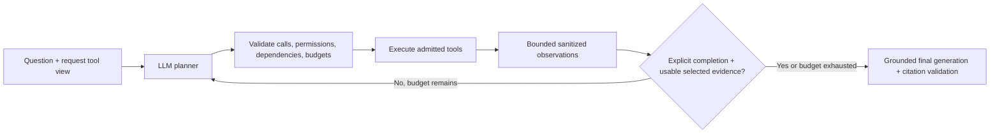

# Central Agent v2: planning, evidence và giới hạn thực thi

## Audit và phạm vi

Baseline là `d8bc36a51ee5d158b95c1eb2cb863dcd431deb16`. Central đã có planner/tool loop, tool view theo request, completion signal, history fallback, native OpenAI continuation, MCP discovery và grounded final generation. Hạn chế chính: hai rounds mặc định, calls tuần tự, chưa kiểm tra reader input đã được quan sát, chưa có repeat/total/deadline budget chung. Native planner vẫn cần một vòng sau completion; context slicing có thể bỏ mất nguồn cần cho câu hỏi nhiều phần. Tool results không rỗng vốn đã chưa đủ để kết thúc; v2 tiếp tục yêu cầu completion có cấu trúc.

Nhánh thử nghiệm `feat/central-agent-dependency-aware-tools` được đọc để đối chiếu; không dùng làm nền, không thay đổi nhánh đó. Hybrid, retrieval algorithms/indexes, frontend, auth, tool signatures YAML và frozen SFT/offline prompts giữ nguyên. Không thêm framework hay LLM critic.

## Vòng lặp



Planner nhận observations của rounds trước để tự sửa query, đổi tool, đọc trang cụ thể hoặc dừng. Backend kiểm tra completion signal, lỗi/malformed/truncated plan, empty/truncated evidence, pending reader, domain và attachment coverage. Nguồn phải còn trong **selected context** cuối cùng; `final_k` quá nhỏ có thể dẫn đến `selected_evidence_incomplete`. Selection ưu tiên giữ đại diện nguồn bắt buộc, rồi xen kẽ các nhóm retrieval từ mới đến cũ để query tinh chỉnh không bị nhóm đầu chiếm hết chỗ.

Default tăng từ hai lên bốn rounds: đủ cho search → fetch → query bổ sung → fetch. Một câu factual có completion hợp lệ vẫn chỉ planner → retrieval → final, cho cả local và OpenAI. Không có LLM call bổ sung để đánh giá sufficiency. Đây là đánh giá của planner được chặn bởi kiểm tra backend; không phải chứng minh ngữ nghĩa mọi subquestion đã được trả lời.

## Scheduler và dependency

`app/central/execution.py` tạo executor riêng cho mỗi request. Planner có thể gắn optional `__central_independent=true` cho call không phụ thuộc call khác trong round. Flag chỉ có trên bản copy planner schema, được strip trước execution. Backend chỉ batch nếu tool còn có `ToolExecutionPolicy(read_only=True, parallel_safe=True)`. Nhiều calls tự nó không tạo quyền chạy song song.

- Built-in searches/readers có policy tường minh; `search_history` và `search_uploaded_documents` dùng chung gate `retrieval` vì retriever có trạng thái nội bộ. History có thể overlap với Wikipedia; hai calls cùng retrieval gate phải tuần tự, kể cả khác request.
- Unknown/stateful tools chạy thận trọng; MCP luôn tuần tự trong executor. MCP manager còn serialize từng shared server session qua các request, không coi `readOnlyHint` là chứng nhận concurrency safety.
- Wikipedia fetch chỉ dùng page ID/title đã có trong sanitized observations trước round, cùng language, hoặc exact input có sẵn trong câu hỏi. Web fetch chỉ dùng URL đã quan sát hoặc URL người dùng đưa rõ. Search và speculative fetch trong cùng round không được dùng kết quả chưa tồn tại. Planner nhận `dependency_not_observed` rồi tạo call ở round kế.
- Không có DAG placeholder/substitution cho tool tùy ý. Dependency với nguồn built-in được kiểm tra rõ; với tool động, planner phải tách rounds và backend giữ giới hạn/quyền. Tool name/schema không thay đổi.
- Kết quả được đưa lại theo thứ tự call gốc dù thời điểm hoàn thành khác nhau. Child context/cancel/metrics tách biệt; merge metrics chỉ sau completion. OpenAI replay giữ nguyên reasoning/output items và call IDs; mỗi accepted native call có đúng output, kể cả denied/malformed/over-budget calls. Envelope thiếu/trùng ID bị từ chối trước execution.

## Budgets và dừng an toàn

Xem các biến `CENTRAL_*` trong [Configuration](CONFIGURATION.md). `AgentLimits` immutable; counters/executor riêng từng request. Repeat key dựa trên tên và arguments đã normalize Pydantic defaults, không lưu arguments vào trace.

Deadline 180 giây áp dụng cho **planning + tools**, mỗi tool tối đa 30 giây, bao gồm chờ gate. Cancellation đóng transport/async tasks và truyền cooperative flag cho worker. Python không kill được sync worker đang chạy; worker giữ resource gate tới khi xong, kết quả/progress muộn bị bỏ và không nhập vào evidence request đã dừng.

Evidence observations tối đa 8.000 ký tự/call và 48.000/request. JSON luôn hợp lệ, chỉ chứa trường cho phép và có truncation marker. Khi hết budget, dừng replan; vẫn trả fixed error envelope để đóng các native calls đã nhận. Phần protocol overhead này được đếm riêng (`observation_error_chars`); tối đa 64 envelopes nhỏ ở round cuối, không chứa evidence. `observation_total_chars` là tổng thật, không giấu overhead trong counter evidence.

Planning output budget 40.000 tokens được trừ bằng actual provider usage và cap request tiếp theo; input budget 120.000 được kiểm tra **sau** usage của mỗi round, có thể vượt bởi một request đang chạy. Không có token estimate giả khi provider không báo usage: trace dùng null và `unknown_usage_rounds`. Đây không phải hard USD/account budget. Final generation giữ các provider ceilings và admission controls riêng; deadline planning không thay thế timeout final generation.

Loop hết rounds/calls/repeats/deadline/tokens/observations vẫn có thể sinh final từ evidence đã có, kèm chỉ dẫn nêu phần chưa xác minh. Không có nguồn thì grounded prompt yêu cầu nói thiếu bằng chứng. MCP `failure_policy=fail` tiếp tục abort cả request kể cả Central timeout. Lỗi retrieval không tự chuyển FAISS/Qdrant. Central final của cả hai provider phải có citation khớp evidence mới được lưu thành công; validation nguồn không chứng minh từng claim đúng. Text một phần có thể đã stream trước khi validation cuối thất bại.

## Mã nguồn và prompts

```text
app/central/
  budgets.py       # immutable limits, deadline/cancel wait
  execution.py     # admission, dependencies, scheduler, metric merge
  planning.py      # schema controls, evidence adaptation/selection
  runtime.py       # one-agent plan/observe/replan/final harness
app/prompts/central/
  agentic_loop.md           # live planner extension
  independent_parameter.md # model-visible control description
  execution_limit.md       # qualification on incomplete execution
evaluation/agentic/
  cases.json
  run.py
  results.json
tests/
  test_agentic_execution.py
  test_agentic_eval.py
```

`PLANNER_INSTRUCTION` public constant và prompt fixtures cũ không đổi. Live runtime dùng `AGENTIC_PLANNER_INSTRUCTION` nối extension mới. Tất cả 21 Markdown resources validate/cache lúc startup; không network/hot-path file IO. `tools.yaml` không cần đổi: tool names, arguments, defaults và descriptions hiện tại vẫn phù hợp. Parallel safety là quyền executor trong Python, không phải điều YAML/model tự cấp.

## Evaluation có thể tái lập

Tại root repository, trong môi trường test dependencies:

```bash
git fetch origin d8bc36a51ee5d158b95c1eb2cb863dcd431deb16
python -m evaluation.agentic.run --repeats 5
python -m pytest -q tests/test_agentic_execution.py tests/test_agentic_eval.py
```

`run.py` đọc read-only planning/runtime của baseline qua `git show`; cả hai dùng cùng current adapters/registry/citation filter và fake tools. Đây là so sánh **harness**, không phải toàn bộ deployment cũ. Scripted decisions giống nhau; control mới chỉ gửi khi schema hỗ trợ. CI chạy fixture contracts không cần fetch Git history hay API key. Report có source hash để phát hiện kết quả cũ khi code thay đổi.

| Metric, 9 cases | Baseline | V2 |
| --- | ---: | ---: |
| Task đủ evidence + completion + native correlation/dependency | 5/9 | 8/9 |
| Dependency ordering hợp lệ | 8/9 | 9/9 |
| Calls thừa | 2 | 0 |
| Calls trùng thực thi lại | 1 | 0 |
| Planning calls tổng | 15 | 16 |
| Simulated input/output tokens | 1500/300 | 1600/320 |

Case còn lại cố ý thiếu bằng chứng và gọi lặp; dừng an toàn là đúng, không tính là hoàn thành nghiên cứu. Simple native factual giảm hai planner calls xuống một; nghiên cứu ba chiến dịch cần ba rounds thay vì bị chặn ở hai. Independent searches overlap bằng synchronization tests; mock wall time trong JSON là median năm lượt, phụ thuộc máy, không phải benchmark model/GPU. Citation precision/recall trong report chỉ kiểm tra provenance của một candidate fixture; không phải factuality của câu trả lời LLM.

Prompt/schema dài hơn làm tăng input thật, nhiều vòng nghiên cứu có thể tăng latency và chi phí. Không suy USD từ simulated tokens. Live Luna/Terra/Qwen quality, cold start GPU và external network behavior cần evaluation riêng khi owner khởi động Modal; không có paid requests/deployment trong verification offline này.
