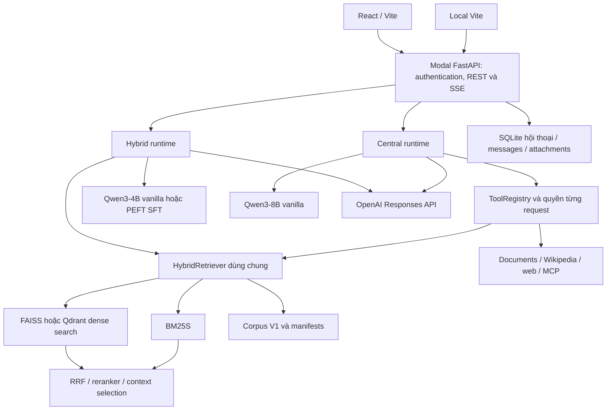

# Kiến trúc hệ thống

Ứng dụng có hai luồng trả lời lịch sử: Hybrid RAG dùng Qwen3-4B và Central Agent dùng Qwen3-8B với công cụ. Hai luồng dùng chung corpus, E5, BM25S, reranker và các dense backend đã validate. Corpus V1 là mặc định; startup chỉ đọc artifacts có sẵn.

Trên Modal, React được build vào image và cùng FastAPI chạy tại `fastapi_app`: một URL HTTPS, session cookie HttpOnly và kiểm tra đăng nhập phía server cho API và giao diện. SSE được truyền trực tiếp. Có thể chọn CPU cho OpenAI-only hoặc GPU cho Qwen; local Vite vẫn hỗ trợ cấu hình backend riêng.

## Trách nhiệm các thành phần

| Mã nguồn | Trách nhiệm |
| --- | --- |
| [`app/main.py`](../app/main.py) | FastAPI lifespan, lắp ráp và đóng service/runtime/tool. |
| [`app/config.py`](../app/config.py) | Settings, ràng buộc model/engine/backend và đường dẫn V1/V0. |
| [`app/api/routes.py`](../app/api/routes.py) | Chat/retrieve, mode/backend dispatch, SSE và disconnect. |
| [`app/api/conversations.py`](../app/api/conversations.py) | Hội thoại, messages và upload attachments theo owner scope. |
| [`app/services/rag_service.py`](../app/services/rag_service.py) | Tải/validate corpus, index, embedder, reranker; giữ tài nguyên dùng chung. |
| [`app/rag/retrieval.py`](../app/rag/retrieval.py) | Query/domain analysis, dense + sparse retrieval, RRF, rerank, context selection. |
| [`app/rag/dense_backend.py`](../app/rag/dense_backend.py) | Adapter FAISS/Qdrant và kiểm tra danh tính kết quả. |
| [`app/rag/hybrid_runtime.py`](../app/rag/hybrid_runtime.py) | Evidence lịch sử/attachments, prompt và Hybrid generation. |
| [`app/central/runtime.py`](../app/central/runtime.py) | Planner, tool loop có giới hạn, evidence và final generation. |
| [`app/models/`](../app/models/) | Protocol, factory Transformers/vLLM, model loading, streaming, adapter identity. |
| [`app/tools/`](../app/tools/), [`app/mcp/`](../app/mcp/) | Built-in tools, request tool policy, MCP discovery/client lifecycle. |
| [`app/chat/`](../app/chat/) | SQLite store và xử lý/tìm kiếm tài liệu upload. |
| [`app/telemetry.py`](../app/telemetry.py), [`app/observability.py`](../app/observability.py) | Request spans, structured logs và process-local serving metrics. |
| [`app/security/auth.py`](../app/security/auth.py) | Xác thực chủ sở hữu, session, CSRF và giới hạn đăng nhập. |

API gọi runtime; runtime gọi retriever/model/tool. Model engine không đọc index. `benchmarks/`, `evaluation/`, `training/` là các workflow offline, không chạy khi ứng dụng startup.

## Khởi động theo APP_MODE

| Mode | Thành phần |
| --- | --- |
| `api-only` — mặc định local | API và conversation store; không tải corpus, retrieval models hoặc Qwen. |
| `retrieval-only` | Thêm corpus, dense backend, BM25S, E5, BGE reranker và attachment services. |
| `full` | Thêm các chat runtime đã bật; MCP khi Central/MCP được bật. |

Trong `full`, Hybrid tải model khi startup; adapter SFT sai làm startup thất bại. Central mặc định tải model khi được gọi (`RUNTIME_LOADING_STRATEGY=lazy`); `eager` tải từ startup. MCP kết nối/discover trong lifespan rồi tái sử dụng clients.

Backend mặc định lỗi làm startup thất bại. Backend tùy chọn lỗi bị đánh dấu unavailable. `/ready` chỉ công bố backend đã validate. Từng request chọn dense backend mà không đổi con trỏ dùng chung; lỗi Qdrant không tự chuyển sang FAISS.

## Hai luồng trả lời

| Mode | Luồng | Model |
| --- | --- | --- |
| `hybrid` | Phân tích câu hỏi → retrieval lịch sử/attachments → cited context prompt → stream câu trả lời. | `Qwen/Qwen3-4B-Instruct-2507`, vanilla hoặc PEFT adapter. |
| `central` | Tool view theo quyền → planner/tool rounds → thu evidence → grounded final prompt → stream câu trả lời. | Vanilla `Qwen/Qwen3-8B`. |

Central mặc định tối đa 2 action rounds và 4 calls/round. Có thể kết thúc sớm theo kiểm tra của runtime. `search_history` dùng cùng retriever/backend của request; fallback chỉ chạy khi được cấp quyền và phù hợp phạm vi kho lịch sử local. Câu hỏi bên ngoài Việt Nam có thể dùng external tools được phép. Tool output là evidence không đáng tin cậy về mặt chỉ dẫn và không thay system prompt. Live Hybrid/Central dùng `LIVE_SYSTEM_PROMPT = SYSTEM_PROMPT + LIVE_STYLE_INSTRUCTION`; explicit offline response modes giữ prompt bytes đã cố định, xem [`prompting.py`](../app/rag/prompting.py).

Engine mặc định là Transformers. vLLM giữ model protocol và HTTP/SSE contract, nhưng hiện yêu cầu vanilla, Linux CUDA và một chat runtime/deployment. Xem [cấu hình](CONFIGURATION.md), [Retrieval](RETRIEVAL.md), [Tools/MCP](TOOLS_AND_MCP.md) và [vLLM](VLLM_LATENCY_EXPERIMENTS.md).

Provider được chọn trên từng request. OpenAI dùng chung Hybrid retrieval và Central tool registry/policy; planner nhận function calls native, giữ call ID và replay reasoning items được mã hóa cùng tool outputs cho vòng sau. Final answer vẫn dùng grounded prompt chung. SSE chỉ chuyển output text, lọc bracket references không khớp evidence, và không lưu câu trả lời chưa hoàn tất. Không tự fallback khi provider lỗi. Client OpenAI được chia sẻ và đóng trong lifespan; model/effort là giá trị riêng của request. LOCAL_INFERENCE_ENABLED=false tránh tải Qwen nhưng retrieval artifacts và models vẫn cần thiết.

## API, lưu trữ và streaming

| Endpoint | Chức năng |
| --- | --- |
| `GET /health` | Liveness và danh tính service. |
| `GET /ready` | Loaded-state, dense/tool/MCP capabilities và model state trong full mode. |
| `POST /api/v1/retrieve` | Retrieval không cần Qwen. |
| `POST /api/v1/chat`, `POST /api/v1/chat/stream` | Trả lời JSON hoặc SSE. |
| `GET /api/v1/ops/summary` | Serving metrics theo process, tắt nếu chưa có admin token. |
| `GET /api/v1/baseline/metadata` | Danh tính model/engine/artifacts và cấu hình cho benchmark. |
| `/api/v1/conversations/...` | Hội thoại, messages và attachments; OpenAPI chạy tại `/docs`. |

Chat request có `conversation_id`, `question`, `mode`, tùy chọn `retrieval_backend`, `final_k`, `attachment_ids`, `debug`; `steering` chỉ dành cho Central. `question` tối đa 1.000 ký tự, ít nhất 2 ký tự sau trim khi không có attachments. Tối đa 5 attachment IDs/request. `final_k` mặc định 6, khoảng 1..10. [`app/schemas.py`](../app/schemas.py) là hợp đồng validation.

SSE gửi `status` theo công việc thực tế, `answer_delta` cho text model sinh, `sources`, `done` và `error` khi lỗi. Nội dung assistant được lưu bằng text đã stream; frontend đồng bộ lại từ server sau hoàn tất. Planner output không hiển thị thành answer deltas. Stop/disconnect truyền cancellation tới generation/tool đang chờ. First status và first answer token là hai mốc khác nhau; Central answer TTFT bao gồm planner/tool time.

SQLite mặc định ở `data/chat.sqlite3`; Modal mount `/data` để giữ hội thoại. `X-Client-ID` xác định anonymous owner scope, không phải xác thực. PDF/ảnh upload được xử lý trong scope hội thoại; OCR cần môi trường tương ứng.

`/ready` trả HTTP 200 ngay cả khi JSON có `ready=false`. Trong full mode, top-level `ready` phản ánh retrieval; model state báo riêng qua `hybrid_loaded`/`central_loaded`. `model_loaded` của RAGService không đại diện Qwen. Cần đọc JSON và kiểm tra request thực tế để xác nhận khả năng trả lời.

Thông số mặc định: [Cấu hình](CONFIGURATION.md). Danh tính/layout dữ liệu: [Artifacts](ARTIFACTS.md). Metric chất lượng và latency: [Evaluation](EVALUATION.md), [Benchmark](BENCHMARKS.md), [Telemetry](RUNTIME_TELEMETRY.md).
