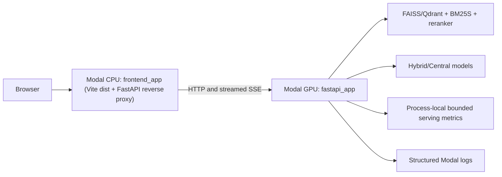

# Serving observability, natural live answers, and cloud-only Modal UI

## Architecture



**Why two containers?** Serving a static page should never allocate an A100/L4. The browser calls the CPU gateway on the same origin. The CPU gateway forwards API traffic to the existing GPU web endpoint without buffering the answer stream. Both are Modal functions inside the same `modal.App`. The GPU remains configured with `min_containers=0` and can cold start when users request a chat.

## Deploy to Modal (PowerShell)

Run from repository root. Existing corpus, model cache volumes and Qdrant secrets remain unchanged.

```powershell
.\.venv\Scripts\python.exe -m pip install modal
.\.venv\Scripts\python.exe -m modal deploy modal_app.py
```

The first deployment prints two endpoints: `fastapi_app` (GPU) and `frontend_app` (CPU). Copy the **GPU** URL, without a trailing slash, and add it to the root **.env** (ignored by Git), or set it in the shell:

```powershell
$env:MODAL_GPU_API_URL = "https://YOUR-GPU-FUNCTION.modal.run"
.\.venv\Scripts\python.exe -m modal deploy modal_app.py
```

Open the **frontend_app** endpoint. No Vite server or frontend process should be needed locally. Changing the GPU endpoint URL requires redeploying the frontend function with the updated `MODAL_GPU_API_URL`. The GPU backend remains available directly for programmatic smoke tests; the browser should use the CPU frontend URL.

To test the new CPU image independently:

```powershell
docker build -f Dockerfile.frontend -t vn-history-ui .
docker run --rm -p 8080:8000 -e MODAL_GPU_API_URL="https://YOUR-GPU-FUNCTION.modal.run" vn-history-ui
```

Then open `http://localhost:8080`, test conversation create/list, uploads, and live SSE chat. The Docker image includes the compiled React/Vite build and **does not** contain models, Hugging Face caches, corpus artifacts, Node dev server, or GPU requirements. `VITE_API_BASE_URL` is optional: blank means same-origin API through the gateway; local Vite setups can still provide an explicit backend origin.

## Monitoring v1

The existing `DeveloperTrace` remains the per-request diagnostic view. The new `ServingMetrics` collector adds process-level aggregates with fixed dimensions (mode, retrieval backend, outcome) and a bounded in-memory sample window:

- In-flight chat requests, request totals by outcome, and observed traffic within the sample window.
- p50/p95 of end-to-end latency, first streamed answer delta, model TTFT, retrieval, generation, planner model latency, and generated tokens/second when the underlying data exists.
- Optional CUDA allocated/reserved/peak memory when Torch CUDA is initialized. This is **not** GPU utilization.
- Known serving engine and whether vLLM prefix caching was configured. Actual **prefix-cache hit rate and KV-cache utilization are null** until supported by the engine. The Hugging Face weight cache must not be mistaken for a response cache or vLLM prefix cache.
- A structured `serving_request` log for each completed, errored, or cancelled request, without prompts, answers, owner IDs, source text, or custom high-cardinality labels.

The summary endpoint is disabled by default. Create a Modal secret containing `OBSERVABILITY_ADMIN_TOKEN` and configure `MODAL_OBSERVABILITY_SECRET_NAME` to that secret's name, then redeploy. To read:

```powershell
$headers = @{ Authorization = "Bearer YOUR_ADMIN_TOKEN" }
Invoke-RestMethod "https://YOUR-FRONTEND-FUNCTION.modal.run/api/v1/ops/summary" -Headers $headers
```

A missing admin token returns 404; an invalid token returns 403. Do not put the token in the Vite bundle or commit it. The summary is **process-local, not durable or cluster-wide**, and resets after a Modal scale-to-zero restart. If the deployment runs multiple GPU containers, the endpoint reflects only the serving process that handled the request. Never average percentiles from different replicas as if they were a global p95.

For durable operational history use Modal logs and hosted function metrics:

```powershell
modal app logs vn-history-rag-api --since 2h
modal function metrics vn-history-rag-api/fastapi_app --group gpu --group calls --since 2h --json
modal function metrics vn-history-rag-api/frontend_app --group cpu --group calls --since 2h --json
```

Exact CLI function names may differ by deployed app/version; verify with `modal app info`. Modal function metrics and logs are separate from these process-local application aggregates. Do not attempt Prometheus polling of a scaled-to-zero GPU endpoint solely to keep scrapes alive; a future phase can push OTLP metrics to a managed collector for durable, multi-replica observability.

## Natural response style

`app/rag/prompting.py` applies `LIVE_STYLE_INSTRUCTION` only to live calls with `response_mode=None`. Frozen offline response-mode prompts keep their original system instruction for baseline comparability. Both Hybrid and Central still use one shared grounded final-answer prompt and the existing citation syntax. No changes to chunking, dense retrieval, cross-encoder, adapters, models, decoding settings, planner, or SSE token emission.

Sample adversarial regression question:

> Vì sao Napoleon thua trận Waterloo? Nếu Grouchy dẫn quân tới tiếp viện trong khi đi truy kích quân Phổ thì cục diện có đảo chiều không?

Assertions should distinguish **approximately 30–33 thousand troops under Grouchy** from casualties at Wavre; the former were *not all killed*. A good answer explains Prussian relief of Wellington, French operational decisions, and the timing problem; alternative history is conditional, not a guaranteed French victory. Do not fill absent corpus evidence with guessed dates, distances, or numbers. References in the user's original sample should be checked against the actual retrieved chunks, not copied blindly. The stylistic prompt alone **cannot repair incorrect retrieval or source texts**.

## Validation before merge

```powershell
python -m pytest -q tests/test_serving_observability.py tests/test_frontend_gateway.py tests/test_baseline_runtime.py tests/test_generation_telemetry.py
npm --prefix frontend test
npm --prefix frontend run lint
npm --prefix frontend run build
docker build -f Dockerfile.frontend -t vn-history-ui .
```

On real Modal after deployment, test both chat modes, attachment upload, Qdrant/FAISS selection, developer trace, reconnection, cancellation, HTTP error status, and SSE streaming. Record at least a small A/B set of naturalness/accuracy/citations with frozen questions and generation settings before merging. The current branch has **not** been exercised against the account's real Modal volumes or GPU; deploying requires the user's authenticated Modal CLI and secrets.

## Security / operations

`X-Client-ID` identifies anonymous conversation ownership but **is not authentication**. A public deployment should implement proper authentication, abuse throttling and rate limits before advertising its URL widely. An admin token is required for ops data. Never print passwords, model prompts, uploaded documents, or private Qdrant keys in metrics or logs.
